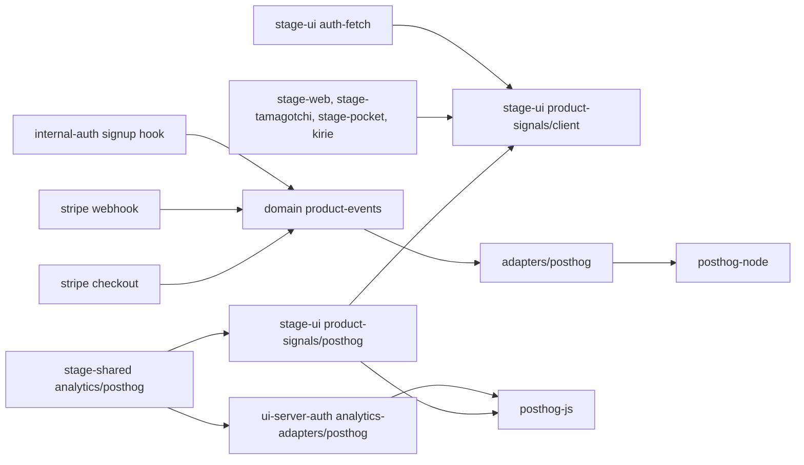
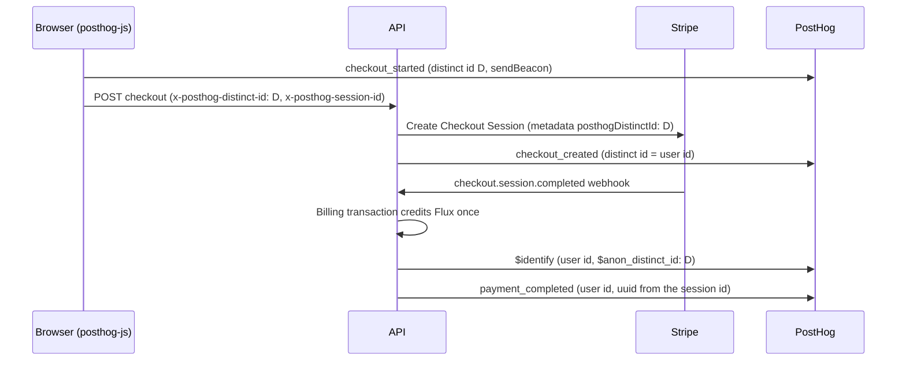

# Product analytics on PostHog

Status: proposed

## Context

moeru-ai/airi #2480 moved product analytics from PostHog Cloud to a self-hosted OpenPanel project in 2026-09. The main reason was the PostHog bill.

OpenPanel does not have several functions that AIRI needs, for example feature flags, experiments, and SQL queries. The self-hosted stack also needs operation work: backups, snapshots, and image upgrades.

The old PostHog bill came mostly from the configuration, not from the business events:

- Autocapture sent clicks, form changes, and page leaves.
- The docs site sent anonymous traffic into the same project.
- The API sent one `$ai_generation` event for each model call.

## Decision

All clients and the API send product events to the shared PostHog project again. The configuration captures only the declared business events and route page views.

### Clients

`packages/stage-shared/src/analytics/posthog.ts` owns the project key, the `t.airi.build` proxy host, and these options:

| Option | Value | Why |
| --- | --- | --- |
| `capture_pageview` | `history_change` | Route views are the base of the funnels. |
| `capture_pageleave`, `autocapture`, `rageclick`, `capture_dead_clicks`, `capture_heatmaps` | Off | Each one adds events that no report uses. |
| `capture_exceptions`, `disable_session_recording`, `disable_surveys`, `disable_web_experiments`, `disable_product_tours`, `disable_conversations` | Off | PostHog bills each product separately. Turn one on only with its own decision. |
| `advanced_disable_flags` | On | No client reads a remote flag now. Flag requests are billed. |
| `person_profiles` | `identified_only` | Anonymous events cost less than identified events. |
| `before_send` | `stripPosthogUrlQueries` | Removes query strings and fragments from URL properties, so OAuth codes never enter PostHog. |

The stage adapter (`packages/stage-ui/src/libs/product-signals/posthog.ts`) keeps the behavior of the OpenPanel adapter:

- The app consent setting wins over the consent that PostHog stores.
- Logout and a consent change start a new device identity with `reset(true)`. `reset` also clears the stored consent and the super properties, so the adapter sets them again.
- An event before a navigation uses `sendBeacon`.

The auth UI uses the same shared options with `app_surface: 'auth'`.

PostHog stores the device id in local storage and a cookie. The anonymous visitor count is therefore persistent across tabs. The OpenPanel device id was only for one tab session.

### API

`services/adapters/posthog.ts` sends confirmed funnel facts (`signup_completed`, `checkout_created`, `payment_completed`) with `posthog-node`:

- Each fact uses `captureImmediate`. It has one attempt and a timeout of five seconds, because the signup hook waits for it.
- A checkout carries the browser distinct id and session id in the `x-posthog-distinct-id` and `x-posthog-session-id` headers. Stripe metadata keeps them for the webhook.
- When the browser distinct id is not the user id, the adapter first sends `$identify` with `$anon_distinct_id`. This merges the anonymous visit into the user.
- A source event id gives a stable UUID v5 for each event, so a repeated delivery has the same uuid.
- The billing transaction still suppresses replayed payment webhooks.
- The domain service rejects metadata keys that start with `$`, and the other reserved keys.

`POSTHOG_PROJECT_KEY` turns on server forwarding. Without it, the API sends no product events. `POSTHOG_API_HOST` defaults to `https://t.airi.build`.

### Module dependency graph



### Affected files

```text
packages/stage-shared/src/analytics/posthog.ts            (new, replaces openpanel.ts)
packages/stage-ui/src/libs/product-signals/posthog.ts      (new, replaces openpanel.ts)
packages/stage-ui/src/libs/auth-fetch.ts                   (identity header names)
apps/ui-server-auth/src/modules/analytics-adapters/posthog.ts
apps/{stage-web,stage-tamagotchi,stage-pocket,stage-tamagotchi-kirie}/.../main.ts
server/apps/api/src/services/adapters/posthog.ts           (new, replaces openpanel.ts)
server/apps/api/src/services/domain/product-events.ts
server/apps/api/src/routes/stripe/operations/{checkout,webhook}.ts
server/apps/api/src/libs/env.ts
server/apps/api/src/app.ts
```

### Checkout attribution sequence



## Scope and non-goals

- Out of scope: a copy of the OpenPanel events into PostHog. The events of 2026-09 to 2026-11 stay in OpenPanel.
- Out of scope: the shutdown of the OpenPanel host. `deploy/openpanel/README.md` stays until the host is shut down.
- Out of scope: remote feature flags, session replay, error tracking, and LLM analytics. Each one needs its own decision and a billing limit.
- Out of scope: per-generation events. Generation data stays in `llm_request_log`.
- Out of scope: the docs site. It sends no events.
- A Checkout Session that a client started before the deployment carries the OpenPanel metadata. Its `payment_completed` event has no browser identity.

## Test plan

- `packages/stage-shared/src/analytics/posthog.test.ts`: URL properties and person properties lose their queries and fragments.
- `packages/stage-ui/src/libs/product-signals/posthog.browser.test.ts`: with the real SDK, consent drops events, logout gives a new device id, super properties stay after a reset, and no `$opt_in` or `$autocapture` event is sent.
- `server/apps/api/src/services/adapters/posthog.test.ts`: `$identify` comes before the fact, replays have the same uuid, and a rejected request has one attempt and does not throw.
- `server/apps/api/src/services/domain/product-events.test.ts`, `routes/stripe/checkout.test.ts`, `routes/stripe/route.test.ts`: the identity headers reach Stripe metadata and the sink.
- `packages/stage-ui/src/libs/auth-fetch.test.ts`: the identity headers go only to the API origin.
- Before the release: set `POSTHOG_PROJECT_KEY` on the API deployment. Set a billing limit for each PostHog product. Send one marked browser event and one server event, and confirm them in PostHog.
